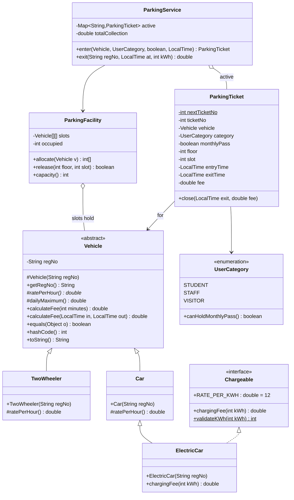

# Task 6: Design the Inheritance Hierarchy (4 marks)

## 1. Superclass, subclasses and type of inheritance

```
                    Vehicle  (abstract)
                   /                 \
           TwoWheeler                Car
                                       \
                                   ElectricCar  ──implements──►  «interface» Chargeable
```

- **Hierarchical inheritance:** `TwoWheeler` and `Car` both extend `Vehicle`.
- **Multilevel inheritance:** `Vehicle` → `Car` → `ElectricCar`. An EV *is a* car: same parking rate, same size, plus charging.
- Java has no multiple inheritance of classes. `ElectricCar` gets its second behaviour (charging) from the **interface** `Chargeable`.
- **Users (student / staff / visitor):** these are *not* modelled with inheritance. They differ only in **data** (whether a pass is allowed), not in behaviour, so an `enum UserCategory` is enough. A subclass for each would add classes with no new behaviour. (In Task 12, passes become objects because their *behaviour* differs.)

## 2. UML class diagram


(GitHub renders this Mermaid block as a diagram. A `.png` copy is in `uml/class-diagram.png`.)

## 3. What is inherited and what is added

| Class | Inherits | Adds / overrides |
|---|---|---|
| `Vehicle` | `Object` | `regNo`, fee algorithm, `equals`/`hashCode`/`toString` |
| `TwoWheeler` | everything in `Vehicle` | overrides `ratePerHour()` → 10 |
| `Car` | everything in `Vehicle` | overrides `ratePerHour()` → 30 |
| `ElectricCar` | everything in `Car`, including rate 30 | implements `chargingFee()` (Rs 12/kWh). In the trace demo it also adds the field `batteryKWh` and overrides `describe()`. |

`regNo` is `private` in `Vehicle`. Subclasses inherit it but cannot read it directly, so they use `getRegNo()`. This keeps encapsulation (Task 10).

## 4. How `super` is used

| Use | Example |
|---|---|
| Constructor | `Car(String regNo) { super(regNo); }`. It must be the first statement, and it passes the registration number up to `Vehicle`, which validates and stores it. |
| Method | `ElectricCar.describe()` returns `super.describe() + ", battery " + batteryKWh + " kWh"`, extending the parent's text instead of rewriting it. |
| Field | `protected final int wheels` is set by `Vehicle`'s constructor through `super(regNo, 4)`. The private `regNo` is reached only through the inherited `getRegNo()`. |

## 5. Constructor execution order for `new ElectricCar(...)`: trace

From `ConstructorTrace.java` (`output/ConstructorTrace.png`):
```
new ElectricCar("TN03C3", 40):
  [static] Vehicle class loaded
  [static] Car class loaded
  [static] ElectricCar class loaded
  1. Vehicle(regNo, wheels) runs  - sets regNo and wheels
  2. Car(regNo) runs              - after Vehicle
  3. ElectricCar(regNo, kWh) runs - after Car
Result: ElectricCar TN03C3, 4 wheels, battery 40 kWh
```
1. The JVM loads the classes **top-down** (superclass first), and each static block runs once.
2. `ElectricCar(...)` is called. Its first statement `super(regNo)` calls `Car(...)`.
3. `Car(...)` calls `super(regNo, 4)`, which calls `Vehicle(...)`. `Vehicle` implicitly calls `Object()`.
4. The bodies then finish **bottom-up from the top**: `Vehicle` body → `Car` body → `ElectricCar` body.

So the parent part of the object is always fully built before the child's constructor body uses it.

---

## Alternative Concept and Complexity Analysis: inheritance vs composition

**Composition design** (in `ConstructorTrace.java`):
```java
final class VehicleType { final String name; final double ratePerHour; }
final class ComposedVehicle {
    final String regNo;
    final VehicleType type;                       // has-a
    double calculateFee(int minutes) { return ((minutes + 59) / 60) * type.ratePerHour; }
}
VehicleType TRUCK = new VehicleType("TRUCK", 50); // new type = new data, no new class
```
Output: `TN09T9 TRUCK 130 min -> Rs 150.0`

| | Inheritance (Car is-a Vehicle) | Composition (Vehicle has-a VehicleType) |
|---|---|---|
| Add a vehicle type that differs **only in rate** | Write 1 new subclass (≈ 4 lines) and recompile | Create 1 new `VehicleType` object. It could even be read from a config file with **no code change**. |
| Add a type with **different behaviour** (EV charging, van peak pricing) | Natural: override a method or implement an interface | `VehicleType` needs a strategy object or a type switch, so it grows more complex |
| Time to compute a fee | **O(1)**: one virtual call to `ratePerHour()` | **O(1)**: one extra field dereference (`type.ratePerHour`) |
| Space per vehicle object | header + `regNo` reference | header + `regNo` reference + **one extra reference** to the shared `VehicleType` (4–8 bytes). The `VehicleType` objects themselves are shared: O(k) for k types, not O(n). |
| Type checking | The compiler knows an `ElectricCar` is `Chargeable` | Capabilities must be checked at run time |

**Conclusion:** composition is better when types differ only by **data** (rates). Inheritance is better when they differ by **behaviour** (charging, time-of-day pricing). Our types differ by behaviour, so inheritance is kept. Task 12 shows the trade-off again: rate-only changes would suit composition, while e-bikes and vans need overridden behaviour.

## Files
- `ConstructorTrace.java`: hierarchy, constructor trace, `super` usage, composition alternative
- `uml/class-diagram.png`: UML class diagram
- `output/ConstructorTrace.txt` / `.png`

**Run:** `javac ConstructorTrace.java && java ConstructorTrace`
