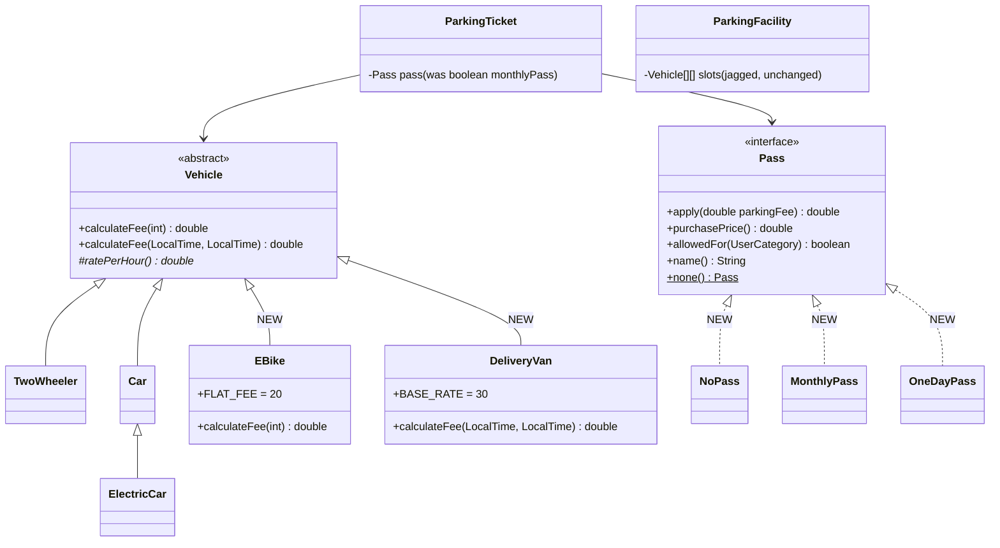

# Task 12: Day-4 Design Challenge: Re-evaluate and Adapt the Design (8 marks)

**Changed requirements:**
1. **E-bikes**: charged a flat fee.
2. **Delivery vans**: charged at **double the car rate between 9 AM and 5 PM**.
3. Visitors may buy a **one-day pass**.
4. The facility grows from 3 to **5 floors, with a different number of slots on each floor**.

**Decision: MODIFY.** Keep the original design, extend it with new subclasses for the vehicles, and make one targeted change: the pass rule becomes an abstraction.

## Run

```bash
cd Task12
javac -d out $(find src -name "*.java")
java -cp out parking.app.ParkingApp input/scenario.txt
java -cp out parking.app.ParkingTests
```

---

## A. Impact Analysis (2 marks)

**What has changed from the original problem**

| Change | Nature |
|---|---|
| E-bike, flat fee | New vehicle type with a *different pricing rule*: not "rate × hours" |
| Delivery van, 2× car rate 9–5 | New vehicle type whose fee depends on the *time of day*, not just the duration |
| One-day pass for visitors | A *second kind of pass*, with different eligibility (visitors only) and a purchase price |
| 5 floors with different slot counts | Layout change |

**Which classes, methods and data structures are affected**

| Element | Affected? | Why |
|---|---|---|
| `Vehicle.calculateFee(int)` | Overridden by `EBike` | Flat fee replaces rate × hours |
| `Vehicle.calculateFee(LocalTime, LocalTime)` | Overridden by `DeliveryVan` | The peak rule needs clock times. This overload already existed (Task 8), and `ParkingService.exit()` already called it, so nothing upstream changes. |
| `VehicleFactory` | **Not edited**; two `register(...)` calls are added in the app | Registry designed for extension |
| `ParkingTicket.monthlyPass` (`boolean`) | **Must change** | A boolean cannot represent "none / monthly / one-day" or a pass price |
| `ParkingService.enter()` / `exit()` | **Must change** | The pass check (`canHoldMonthlyPass`) and the rule "pass → 0" were hard-coded here; a one-day pass must also add its price to the collection |
| `ParkingFacility` (`Vehicle[][]` jagged array) | **No change** | Already jagged |
| `UserCategory` | No change | `canHoldMonthlyPass()` is reused by `MonthlyPass` |

**Why a different number of slots on each floor affects the array design**

A rectangular `new Vehicle[5][100]` would either waste cells (if floors are smaller) or not fit (if a floor is larger). A 1-D array with `index = floor × S + slot` would compute **wrong slots**, because S is no longer one number (see Task 2: index 67 instead of 127). The design already uses a **jagged array** (`slots[f] = new Vehicle[slotsPerFloor[f]]`), and all loops use `slots[f].length`, so a layout of {3, 2, 4, 1, 2} works **with zero code change** (test T12/T13).

**Classes that must be modified rather than extended:** `ParkingTicket` and `ParkingService`, because the pass was data (`boolean`), not behaviour. Everything else is extended.

---

## B. Evaluation of the Original Design (2 marks)

| Question | Finding (with evidence) |
|---|---|
| **Can new vehicle types be added only by writing new subclasses?** | **Yes.** `EBike` and `DeliveryVan` are new files that extend `Vehicle`. `Vehicle`, `TwoWheeler`, `Car`, `ElectricCar` and `VehicleFactory` are **byte-for-byte unchanged** (`diff -rq ../Task11/src src` lists none of them). |
| **Are pricing rules spread across many classes or kept in one place?** | Vehicle pricing is **in one place per type**: the base rule in `Vehicle`, variations in the subclass that needs them. The **pass/discount rule was the exception**: it was buried inside `ParkingService.exit()` as `hasMonthlyPass() ? 0 : fee`, with eligibility checked in both `ParkingService` and `ParkingTicket`. That is the weak spot Task 11 predicted. |
| **Can the existing tested classes remain unchanged?** | **Mostly.** 8 of the 10 domain classes are unchanged. All 25 original Task 11 tests still pass unmodified, except that the boolean pass argument becomes a `Pass` object. |

**Verdict:** the vehicle hierarchy passed the test of change; the pass handling did not. That supports **modify**, not redesign.

---

## C. Adaptation (2 marks)

### Revised class structure



### What changed

| Kind | Classes | Detail |
|---|---|---|
| **Added (6)** | `EBike` | Overrides `calculateFee(int)`: Rs 20 per started day; 0 minutes = 0 |
| | `DeliveryVan` | Overrides `calculateFee(LocalTime, LocalTime)`: walks each started hour; an hour that **starts** in 09:00–16:59 costs 2 × 30 = 60, otherwise 30; daily cap 600 |
| | `Pass` (interface) | `apply()` gives the payable parking fee; `purchasePrice()` (default 0); `allowedFor()` (default true); static `none()` |
| | `NoPass` | Full fee; single shared instance (no state) |
| | `MonthlyPass` | Fee 0; allowed only if `category.canHoldMonthlyPass()` (same rule as before, now in one place) |
| | `OneDayPass` | Fee 0; price Rs 100 collected at the gate; visitors only |
| **Modified (2)** | `ParkingTicket` | `boolean monthlyPass` → `Pass pass`; eligibility check delegated to `pass.allowedFor()` |
| | `ParkingService` | `enter(..., Pass, ...)` adds `pass.purchasePrice()` to the collection; `exit()` uses `pass.apply(v.calculateFee(in, out))`, which is **two dynamic dispatches** and no `if` on pass type |
| **Unchanged (8)** | `Vehicle`, `TwoWheeler`, `Car`, `ElectricCar`, `Chargeable`, `UserCategory`, `ParkingFacility`, `VehicleFactory` | |
| App/test | `ParkingApp` | Registers the new types: `VehicleFactory.register("E_BIKE", EBike::new)`; parses pass names |

**Assumptions made for the new rules:** e-bike flat fee is Rs 20 per started day; the one-day pass costs Rs 100; a van hour is "peak" if it *starts* at or after 09:00 and before 17:00; a pass covers parking only, so EV charging is still billed.

---

## D. Evidence-Based Defence (2 marks)

### Number of existing classes that had to change

**2 of 10** domain classes were modified (`ParkingTicket`, `ParkingService`), plus the app entry point. Both changes come from one root cause: the pass was a `boolean`. **0** vehicle classes changed. A full redesign (for example, moving all pricing into a `PricingRule` strategy) would have touched `Vehicle` and every subclass, which is all tested code, to fix a problem that exists only in the pass handling.

### Ease of adding a further vehicle type in future

Adding, for example, a bus now takes:
```java
public class Bus extends Vehicle {                    // 1 new file
    public Bus(String r) { super(r); }
    @Override protected double ratePerHour() { return 60; }
}
VehicleFactory.register("BUS", Bus::new);              // 1 line in the app
```
No existing class is edited. A new pass type (weekly, staff-guest) is likewise one new class implementing `Pass`.

### Test results for the new categories

All **38 / 38** tests pass (`output/ParkingTests.png`): the 25 original tests (regression) plus 13 new ones.

| ID | Test | Expected | Actual | Result |
|---|---|---|---|---|
| T1 | E-bike 4 h → flat fee | 20.0 | 20.0 | PASS |
| T2 | E-bike 0 min | 0.0 | 0.0 | PASS |
| T3 | E-bike 25 h → 2 started days | 40.0 | 40.0 | PASS |
| T4 | Van 07:30–10:30 (30 + 30 + 60) | 120.0 | 120.0 | PASS |
| T5 | Van 13:00–18:00 (4 × 60 + 30) | 270.0 | 270.0 | PASS |
| T6 | Van 08:59–09:59: hour starts off-peak | 30.0 | 30.0 | PASS |
| T7 | Van 16:59–17:59: hour starts in peak | 60.0 | 60.0 | PASS |
| T8 | Van all day, capped | 600.0 | 600.0 | PASS |
| T9 | Visitor one-day pass: Rs 100 at gate, 0 at exit | 100.0/0.0 | 100.0/0.0 | PASS |
| T10 | Student buying a one-day pass | IllegalArgumentException | IllegalArgumentException | PASS |
| T11 | Factory creates registered `E_BIKE` | EBike[TN11E1] | EBike[TN11E1] | PASS |
| T12 | 5 floors {3,2,4,1,2}: 12th vehicle | [4, 1] | [4, 1] | PASS |
| T13 | 13th vehicle on the 12-slot facility | null | null | PASS |

**Scenario** (`input/scenario.txt`, 5 floors {3, 2, 4, 1, 2}), hand calculation:

| Event | Calculation | Rs |
|---|---|---|
| One-day pass sold to TN12CC1212 at 08:10 | pass price | 100 |
| Van TN10VV1010 07:30–10:30 | 07:30 (30) + 08:30 (30) + 09:30 peak (60) | 120 |
| EV TN14EV1414 08:30–11:30, 10 kWh | 3 h × 30 + 10 × 12 | 210 |
| E-bike TN11EB1111 08:00–12:00 | flat | 20 |
| Car TN12CC1212 (one-day pass) exits 18:00 | pass | 0 |
| Van TN17VV1717 13:00–18:00 | 13, 14, 15, 16 peak (4 × 60) + 17:00 (30) | 270 |
| Car TN13CC1313 (staff, monthly) exits 18:30 | pass | 0 |
| Rejected: student one-day pass, visitor monthly pass, unknown type TRUCK | — | — |
| **Total** | | **720** |

Program: `Total collection : Rs 720.00` (`output/ParkingApp.png`). This matches.

### Trade-offs

| Gained | Given up |
|---|---|
| New vehicles and passes are added by extension only | `ParkingTicket` and `ParkingService` had to be edited once, and their tests updated |
| Pass eligibility and discount now live in **one** place per pass type | One extra object per ticket (`Pass`); `NoPass` is shared, so the cost is mostly zero |
| Van pricing is exact per hour | Van fee is O(h) in the number of hours (a loop) instead of O(1). With h ≤ 24 this is trivial |
| `EBike` reuses the hierarchy without touching `Vehicle` | `EBike.ratePerHour()` exists only because `Vehicle` requires it. A future `PricingRule` strategy would remove this smell, at the cost of the larger redesign rejected above |
| No change to the slot structure | Allocation is still a linear scan; fine for ~500 slots |

### Final decision

The analysis showed one specific weakness (pass = `boolean`) and a hierarchy that already absorbed new vehicle types without edits. The proportionate response is therefore to **modify**: keep the hierarchy, extend it with `EBike` and `DeliveryVan`, and replace the boolean with a `Pass` abstraction. The evidence for this is 2 modified classes, 8 unchanged, 38/38 tests passing, and a matching hand-calculated total. A full redesign is not justified, because nothing in the vehicle side of the design failed.

## Files
| Path | Purpose |
|---|---|
| `src/parking/model/EBike.java`, `DeliveryVan.java` | New vehicle categories |
| `src/parking/model/Pass.java`, `NoPass.java`, `MonthlyPass.java`, `OneDayPass.java` | New pass abstraction |
| `src/parking/model/ParkingTicket.java`, `src/parking/service/ParkingService.java` | Modified classes |
| `input/scenario.txt` | Scenario with new categories and 5 uneven floors |
| `output/` | Scenario and test runs (text + screenshots) |
